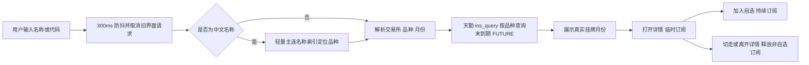

# V1.2.3 基线：合约按需搜索修复

日期：2026-10-26；分支：`codex/contract-search-v1.2.3`；基线提交：`aacb5d6`。

## 问题原因

旧流程在后台下载完整静态合约文件，搜索时先枚举所有期货再补齐元数据。首次下载/解析耗时长，7 天的目录缓存及内置月份可能过时，且加载缓存后便不再请求最新记录。另一个独立缺陷是 `^[A-Z]+\.[a-z]{1,3}\d{3,4}$` 只接受小写品种代码，导致郑商所烧碱 `SH`、纯碱 `SA` 以及中金所大写合约无法进入列表。

## 新流程

天勤官方 `query_quotes` 支持 `class`、`exchange_id`、`product_id`、`expired` 等筛选条件；没有中文模糊查询参数。因此中文先通过 `CONT` 的名称/代码定位品种，每个品种一条主连，不请求所有月份或期权。实现直接使用项目现有 DIFF 连接发送官方 SDK 同样的 `ins_query` 消息，不引入完整 TqSdk 运行依赖。

接口依据：[天勤 API 文档](https://doc.shinnytech.com/tqsdk/latest/reference/tqsdk.api.html#tqsdk.TqApi.query_quotes)、同页 `query_graphql`；协议字段另对照本机已安装官方 SDK `TqApi.query_graphql` 与合约 schema。

## 行为约定

| 场景 | 行为 |
|---|---|
| 启动、空搜索、只选交易所 | 返回空列表，提示输入，不发完整目录请求 |
| `棕榈油2701` / `p2701` | 查询 `p` 的真实当前月份，按年月筛选，不猜测新月份 |
| `烧碱` / `SH`、`纯碱` / `SA` | 保留郑商所大写代码 |
| `SA2701` / `CZCE.SA2701` | 兼容交易所使用的 `SA701` 代码形式 |
| 同品种重复搜索 | 60 秒短缓存；同条件并发合并；空结果缓存 5 秒 |
| 中文品种名称索引 | 缓存 1 小时；实际月份仍按当前品种查询 |
| 上游超时/错误 | 展示查询错误，可回车重试；不把失败当作不存在 |
| 搜索结果 | 不订阅；查询完成后发空 query 释放服务端查询 |
| 打开非自选详情 | 临时订阅当前合约，切走后退订 |
| 自选 | 保留行情；删除后不在重连时重新订阅 |

`/api/v1/instruments` 新增 `limit=1..300`，默认 200；达到上限时 `limited=true`，电脑端提示补充品种或月份。`/api/v1/status` 返回 `catalog_mode=search`，其 `futures_count` 表示本次会话已查询的记录数，不能用作全市场合约数；`catalog_loading` 仅代表当前查询进行中，不表示仍在下载完整目录。`catalog_complete=false` 是有意的，因为运行路径不构建完整目录。

## 验证记录

使用空凭据和模拟协议进行离线测试；使用独立本地 HTTP 端口与模拟 WebSocket 检查两套前端，无真实账户连接。

- Python：覆盖中文/代码/月份、郑商所年月兼容、新品种名称发现、空输入不查询、重复请求合并、缓存到期、刷新、网络失败与不存在的区分、一次性协议释放、最后一只退订和图表释放。
- 界面：Edge / Playwright，电脑 1440×1000，手机前端 390×844。快速从棕榈油改为纯碱后不回显旧结果；搜索本身不发订阅；星标保留自选；切换详情释放临时订阅；空/错误/清空搜索均有对应提示，手机无横向溢出。没有未解释的脚本错误；一次模拟 HTTP 503 用于检查失败提示。
- Python 核心镜像同步到 Android，新增搜索模块也由 `check_core_drift.py --strict` 自动扫描。
- 截图、临时界面脚本和日志保存在本机临时目录 `C:/Users/22051/AppData/Local/Temp/zaquant-contract-search-20261026/`。

真实账户的最新挂牌结果、冷/热查询延迟、Windows 安装运行和 Android 真机覆盖升级仍需实际验收。这些离线结果不代替真实行情及设备证据。

## 最终检查结果

| 检查 | 结果与范围 |
|---|---|
| Python 3.13 全量回归 | 120/120 通过 |
| Python 3.8 搜索/订阅兼容 | 35/35 通过，明确将本工作区插入模块路径 |
| Electron 后端断言 | 3/3 通过 |
| 双端核心漂移 / JS 语法 / diff 空白检查 | 均通过 |
| UI 搜索流程 | 电脑 1440×1000、手机 390×844 均通过；含离线删除后重连退订、元数据保留、手机首页不创建额外图表 |
| Android 构建 | `gradlew.bat --no-daemon --offline assembleDebug` 成功 |
| APK 内容 | 7 个关键 Python/前端文件与最终源码逐字节一致 |

Debug 包位置：`mobile-app/app/build/outputs/apk/debug/app-debug.apk`。

大小：26763706 字节；SHA-256：`4cb9a8c7b578928d19e0b12423e0cc4772facee6126daf53d84c27f839d27204`。

构建机 Python 为 3.13，Chaquopy 提示不能为 3.8 预编译 `.pyc`，故包中保留源码；上面的 Python 3.8 相关回归及源码内容检查已完成。此 Debug 包仅供独立测试，不是正式签名覆盖升级包；本次未安装到真机、未发布 Release。

Python 3.8 验证只覆盖适用于内嵌后端的搜索/订阅相关测试，不声称通过整个桌面 HTTP 测试集。其专用运行环境不含 FastAPI；旧 KlineDiffMerge 测试在 3.8 下还有事件循环创建顺序依赖。桌面完整测试使用项目 Python 3.13 环境通过。
